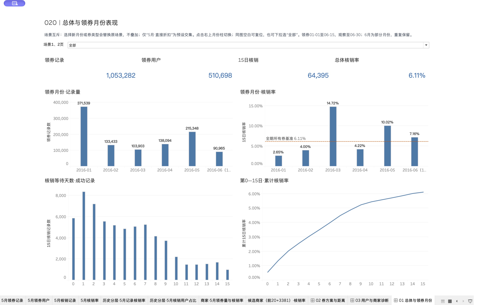
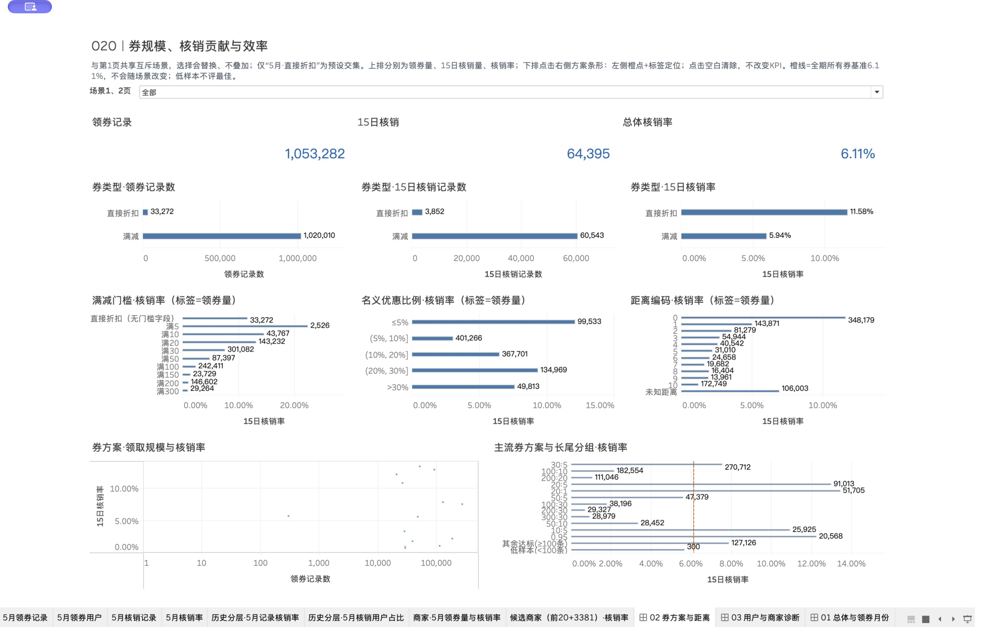
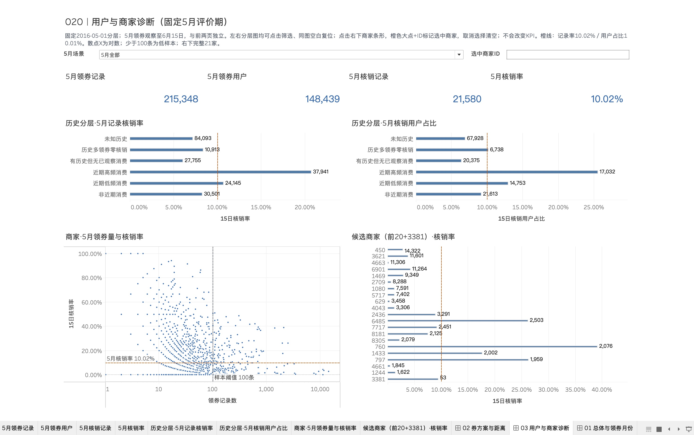

# O2O 优惠券核销分析与用户分层

使用 Python、DuckDB SQL 和 Tableau，对2016年O2O历史优惠券记录开展核销分析、可比范围复核及用户分层。**这是Agent辅助的个人分析作品**，不代表企业委托、实习经历或线上营销成果；本人独立贡献与工具熟练程度需本人确认。

## 研究问题与主要结果

- 优惠券领取后，有多少在0—15日内核销？
- 券方案、距离、月份和商家之间的差异，在共同支持范围内是否仍存在？
- 在2016-05-01冻结历史特征后，不同用户群体在5月如何表现？

|指标|分子 / 分母|结果|
|---|---|---|
|线下原始记录|1,754,884条|不是订单数|
|15日记录核销率|64,395 / 1,053,282条有效成熟领券|6.1137%|
|核销用户占比|40,075 / 510,698名领券用户|7.8471%|
|5月后续记录核销率|21,580 / 215,348条领券|10.0210%|
|历史与5月评价用户并集|501,041人|不是5月1日可触达名单|

原始重复记录保留，完全去重仅作敏感性分析；未知距离保留unknown。核销率是样本中的观察结果，不能解释为ROI、利润或营销因果提升。

## 三页看板

### 总体与领券月份

### 券方案与距离

### 用户与商家诊断

看板有24张工作表、6项参数动作和23个预设范围。选择场景会替换当前范围，不支持任意条件叠加。仓库提供截图；TWBX和原始/用户明细数据不随本次展示发布。

## 代码与阅读入口

- [分析结论与候选建议](o2o_work/docs/结论与建议.md)
- [复现指南和验证边界](o2o_work/docs/复现与交付说明.md)
- [数据字典](o2o_work/docs/数据字典.md)、[指标字典](o2o_work/docs/指标字典.md)、[输入版本](o2o_work/docs/输入清单.md)
- [SQL专题与分层](o2o_work/sql/)；[Python流水线](o2o_work/scripts/)
- [阶段2 Notebook](o2o_work/notebooks/阶段2专题与复核.ipynb)、[阶段3 Notebook](o2o_work/notebooks/阶段3历史分层与后续评价.ipynb)
- [看板技术配置](o2o_work/docs/阶段4看板配置与复现.md)

阶段2包括六专题、共同范围及标准化比较；阶段3采用历史RF和领券特征形成六个互斥群体，并以5月后续表现评价。历史事件必须早于2016-05-01，历史15日核销率只用最晚4月15日领取的成熟券，防止未来信息进入历史特征。没有金额，因此不称完整RFM。

## 数据与复现

来源线索：[天池数据集38115](https://tianchi.aliyun.com/dataset/38115)。原始数据的再分发许可尚未独立确认，本仓库仅发布代码、分析文本、汇总结果和截图。原始CSV、数据库、用户明细、虚拟环境和完整历史qa均未上传。请自行取得有权使用且指纹匹配的输入数据。

Python 3.11；依赖和具体操作见复现指南。两个Notebook可使用随仓库发布的汇总表重跑，完整阶段0—4需要原始输入与Tableau资源。本地历史stage5/6凭据未发布，不能从GitHub克隆版继承本地验收状态。

线上行为增强、预测模型、CRM发送、随机实验和收入/成本分析均未实施。仓库展示已形成的代码与结果，不证明本人独立完成全部工作。

## 发布前验证

三个Notebook（输入指纹、阶段2、阶段3）已实际执行成功；19项单元/集成测试在本机原始输入可用时通过。无原始CSV的克隆版会跳过依赖原始输入的阶段0集成测试，其余测试可独立运行。未在另一台机器完成全流程重建。
